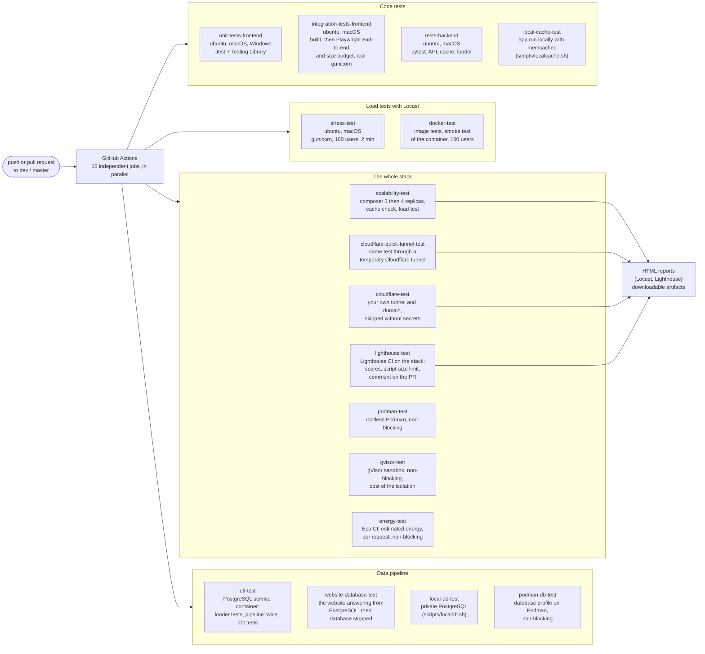
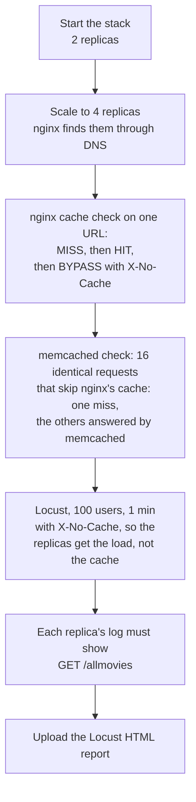

# Deatils of CI/CD: executed tests

CI CD mainly executes unit tests, as well as end to end tests using differents setups and environments, and for stress tests. 

`.github/workflows/build_test.yml` runs on every push and pull request to `dev` and `master`. It has 17 jobs with no dependency between them, so they all start at the same time (some run on several operating systems).



| Job | What it runs | It fails when |
|---|---|---|
| `unit-tests-frontend` | `npm ci`, then Jest tests of the page, the infinite scroll, the reload on filter change, the movie card and the browser-side cache (a page already seen is not requested again, a failed or cancelled request is not cached) | a test fails (the npm debug log is printed if `npm ci` itself fails) |
| `integration-tests-frontend` | builds the React app, then Playwright drives a real browser against gunicorn: 20 cards, then 40 after scrolling, and the navigation to the statistics page. It also checks the **size budget** (`budget.spec.js`): gzipped JavaScript, requests and flag files of the home page, and the extra download of the statistics page (the charts must be a separate, lazy chunk); the table goes to the job summary | an end-to-end test fails, or a page downloads more than its limit in `frontend/performance-budget.json` |
| `tests-backend` | `pytest`: the API (status, title, language and score filters), the two-level cache (against a fake memcached server) and the loader | a test fails |
| `stress-test` | gunicorn started locally, then Locust for 2 minutes with 100 users | any request is not a `201` with the expected JSON key (Locust then exits with code 1) |
| `docker-test` | builds the Docker image, then (1) runs the image's own tests (`MODE=test`, in the foreground, so a failing test fails the job), (2) starts the container and waits until it answers, (3) smoke-tests it: the React build and its JavaScript are served, the API answers `201`, a language filter and a sort are really applied, the cache answers `miss` then `memory`, the process is not root and gunicorn uses the threaded workers, (4) load-tests it with Locust (100 users, 2 minutes) | the image does not build, a test fails, a smoke check fails, or a Locust request fails |
| `scalability-test` | see the diagram below | a step fails, or a replica received no request |
| `cloudflare-quick-tunnel-test` | 4 replicas behind a temporary `trycloudflare.com` URL (no account needed), Locust through it, every replica must have received requests | same as above |
| `cloudflare-test` | the same through your own tunnel and domain. Skipped unless the repository has the `CLOUDFLARE_TUNNEL_TOKEN` secret and the `CLOUDFLARE_URL` variable, and on pull requests from forks | a load-test request fails |
| `podman-test` | the stack on rootless Podman: it starts, the API answers, nginx's cache and memcached work, the containers do not run as root | a step fails (the job does not block the others yet: `continue-on-error`) |
| `gvisor-test` | installs gVisor, checks that a throw-away container boots its own kernel, then load-tests the plain stack and the stack started with `docker-compose.gvisor.yml` (`app`, `nginx`, `memcached` in the sandbox, runtime `runsc-hostnet`), checks that they really run in it (runtime, and a kernel version that is not the host's) and still work (API, nginx and in-process caches). The job summary compares requests per second and latency of the two | a step fails or a Locust request fails (non-blocking while the job is new: `continue-on-error`) |
| `energy-test` | starts the stack, then uses [Eco CI](https://github.com/green-coding-solutions/eco-ci-energy-estimation) to estimate the energy of the runner in three phases: 30 s idle, 40 s of Locust load with the nginx cache bypassed, 40 s with the caches on. `scripts/energy_report.py` reads Eco CI's JSON measurements and adds the energy per request, with and without the share of the idle stack. Nothing is sent outside GitHub (`send-data: false`) | a step fails, or a measurement is missing under the expected label (non-blocking while the job is new: `continue-on-error`) |
| `etl-test` | PostgreSQL as a service container: loader tests, then the pipeline twice (load `raw.movies`, then `dbt build` with its tests), then the website's data source tests (`backend/tests/test_store.py`: the PostgreSQL store must give the same answers as the CSV store, query by query), then checks on the warehouse | a test, a dbt model or a dbt test fails |
| `lighthouse-test` | the whole stack with `docker compose`, then Lighthouse CI 3 times on the home page (`frontend/lighthouserc.json`). The report (scores, timings, downloads, failing accessibility checks, biggest savings) goes to the job summary, to the `lighthouse-reports` artifact and, on pull requests, to a comment (not for forks) | the JavaScript downloaded exceeds 270 KB (scores and timings are only warnings) |
| `local-cache-test` | memcached installed with `apt` and started by `scripts/localcache.sh` (no Docker), the app run locally with 2 gunicorn workers: the same URL 16 times must give one `miss` and answers from `memcached`, and `stats` must show cached items | a step fails, or no answer comes from memcached |
| `website-database-test` | the website on top of the database, in containers: PostgreSQL and the pipeline build the warehouse, the app runs with `DATA_SOURCE=postgres` and must answer from it (`X-Data-Source: postgres`, a language filter and a sort really applied, statistics), then the database is stopped (the API must answer `503` with a message) and started again (it must answer again) | a check fails |
| `local-db-test` | the same pipeline against the private PostgreSQL started by `scripts/localdb.sh` (no Docker) | the pipeline or the final row count fails |
| `podman-db-test` | the database profile on rootless Podman | non-blocking, like `podman-test` |

The Locust test is not a single request: each simulated user waits 1 to 2 seconds between requests and picks one, with these weights (`backend/performance/locustfile.py`):

| Task | Weight | Request |
|---|---|---|
| `browse_page` | 5 | a page of 20 movies, no filter |
| `filtered` | 4 | title, genres, language, minimum score and year range, chosen at random |
| `sorted` | 2 | a random sort field and direction |
| `statistics` | 2 | `/statistics`, with or without a year range |
| `all_movies` | 1 | no parameter: the whole dataset, the worst case |

What `scalability-test` does, step by step:




## Front-end performance

### Bundle size

`scripts/bundle_report.py` shows which packages the JavaScript bundles are made of (it reads the source maps of the build, no dependency to install):

```shell
cd frontend && npm run build && cd ..
python scripts/bundle_report.py --top 15
```

It found that **one package, `react-world-flags`, was 64 % of the main bundle**: it inlines the flags of all 256 countries (3.7 MB) to show at most 27 in the language dropdown. The charting libraries (echarts, recharts) were the second cost. What changed:

| | before | after |
|---|---|---|
| `main.js`, minified | 5,911 KB | **654 KB** |
| `main.js`, gzipped (what nginx sends) | 1,891 KB | **201 KB** |
| the home page downloads | 1 file of 5.9 MB, charts and 256 flags included | 654 KB of JavaScript and 1 KB of CSS; no chart code, no flag |

- **Flags** are 27 small SVG files in `frontend/public/flags/` (one per country of `languages.json`, 94 KB together), displayed by `src/Flag.js`. The browser downloads one only when it is shown, i.e. when the dropdown is opened. Adding a language: copy its country's SVG there (a test checks it).
- **The statistics page** is a separate chunk (`React.lazy` in `src/AppRoutes.js`, 476 KB gzipped, with echarts and recharts), downloaded when the page is opened. It starts downloading as soon as the pointer or the keyboard reaches the "Movies Statistics" link, so the click itself does not wait.
- The statistics chunk still contains two charting libraries (echarts for the box plots, recharts for the rest). Keeping only one would shrink it further.

### Keeping it small: budget and Lighthouse

Two automatic checks run in CI so that the numbers above do not creep back up. Both fail the job when a limit is crossed, and both print a readable report.

**Size budget (Playwright).** `frontend/e2e_tests/budget.spec.js` loads the real site and measures what a first visit downloads, gzipped as nginx sends it (the posters, which come from TMDB, are not counted). The limits are in `frontend/performance-budget.json`:

| | measured | limit |
|---|---|---|
| home page: JavaScript | 230 KB | 260 KB |
| home page: requests to the site / API requests / flag files | 4 / 1 / 0 | 6 / 1 / 0 |
| statistics page: extra JavaScript (the charts) | 550 KB | 620 KB |
| statistics page: API requests | 2 | 2 |

It runs with the other end-to-end tests (`cd frontend && npx playwright test`, after `npm run build`). The table appears in the job summary of the run. Raise a limit only on purpose, in the same pull request as the change that needs it.

**Lighthouse CI.** The `lighthouse-test` job starts the whole stack (nginx compresses and sets cache headers, as in production) and runs [Lighthouse](https://developer.chrome.com/docs/lighthouse) 3 times on the home page (`frontend/lighthouserc.json`). The report (scores, timings, what is downloaded, failing accessibility checks, biggest savings) is added to the job summary, uploaded as the `lighthouse-reports` artifact (with the full HTML reports) and, on pull requests, posted as a comment that is updated at each push. Only the amount of JavaScript downloaded is a hard limit (270 KB); the scores and timings are warnings, because they vary from run to run. To read a run you did yourself: `python scripts/lighthouse_summary.py`. (Running `lhci` on WSL leaves its temporary Chrome profiles, about 12 MB each, in folders named like `C:\Users\...\lighthouse.XXXXXX` in the current directory: git ignores them, delete them after a local run. CI is not affected.)

The first report already shows work to do: accessibility scores 86 (the language select and the two handles of the year slider have no accessible name, the active navigation link has too little contrast, and the movie titles are `h6` headings right after the page's `h1`), and about 240 KB of JavaScript that the home page downloads but does not use.
