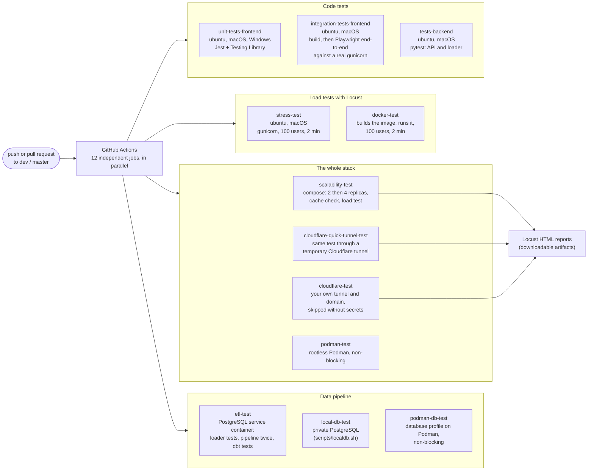
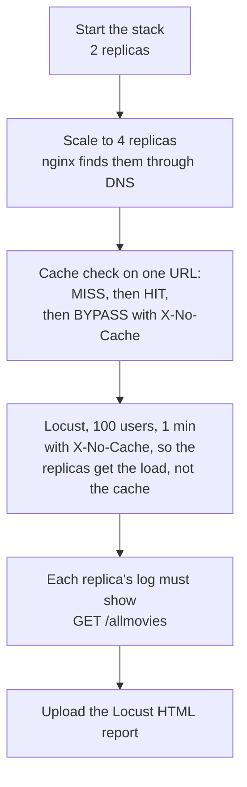

# Deatils of CI/CD: executed tests

CI CD mainly executes unit tests, as well as end to end tests using differents setups and environments, and for stress tests. 

`.github/workflows/build_test.yml` runs on every push and pull request to `dev` and `master`. It has 12 jobs with no dependency between them, so they all start at the same time (some run on several operating systems).

| Job | What it runs | It fails when |
|---|---|---|
| `unit-tests-frontend` | `npm ci`, then Jest tests of the page, the infinite scroll, the reload on filter change and the movie card | a test fails (the npm debug log is printed if `npm ci` itself fails) |
| `integration-tests-frontend` | builds the React app, then Playwright drives a real browser against gunicorn: 20 cards, then 40 after scrolling, and the navigation to the statistics page | an end-to-end test fails |
| `tests-backend` | `pytest`: the API (status, title, language and score filters) and the loader | a test fails |
| `stress-test` | gunicorn started locally, then Locust for 2 minutes with 100 users | any request is not a `201` with the expected JSON key (Locust then exits with code 1) |
| `docker-test` | builds the Docker image, runs it, runs Locust against the container, then starts the image's own test mode | the build fails or a Locust request fails (the test-mode run is started but its result is not checked yet) |
| `scalability-test` | see the diagram below | a step fails, or a replica received no request |
| `cloudflare-quick-tunnel-test` | 4 replicas behind a temporary `trycloudflare.com` URL (no account needed), Locust through it, every replica must have received requests | same as above |
| `cloudflare-test` | the same through your own tunnel and domain. Skipped unless the repository has the `CLOUDFLARE_TUNNEL_TOKEN` secret and the `CLOUDFLARE_URL` variable, and on pull requests from forks | a load-test request fails |
| `podman-test` | the stack on rootless Podman: it starts, the API answers, the cache works, the containers do not run as root | a step fails (the job does not block the others yet: `continue-on-error`) |
| `etl-test` | PostgreSQL as a service container: loader tests, then the pipeline twice (load `raw.movies`, then `dbt build` with its tests), then checks on the warehouse | a test, a dbt model or a dbt test fails |
| `local-db-test` | the same pipeline against the private PostgreSQL started by `scripts/localdb.sh` (no Docker) | the pipeline or the final row count fails |
| `podman-db-test` | the database profile on rootless Podman | non-blocking, like `podman-test` |

The Locust test is not a single request: each simulated user waits 1 to 2 seconds between requests and picks one, with these weights (`backend/performance/locustfile.py`):

| Task | Weight | Request |
|---|---|---|
| `browse_page` | 5 | a page of 20 movies, no filter |
| `filtered` | 4 | title, genres, language, minimum score and year range, chosen at random |
| `sorted` | 2 | a random sort field and direction |
| `statistics` | 2 | `/statistics`, with or without a year range |
| `all_movies` | 1 | no parameter: the whole dataset, the worst case |

What `scalability-test` does, step by step:

