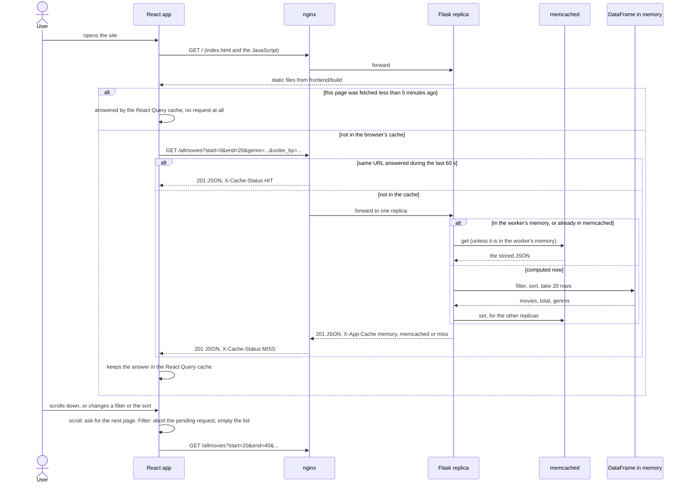
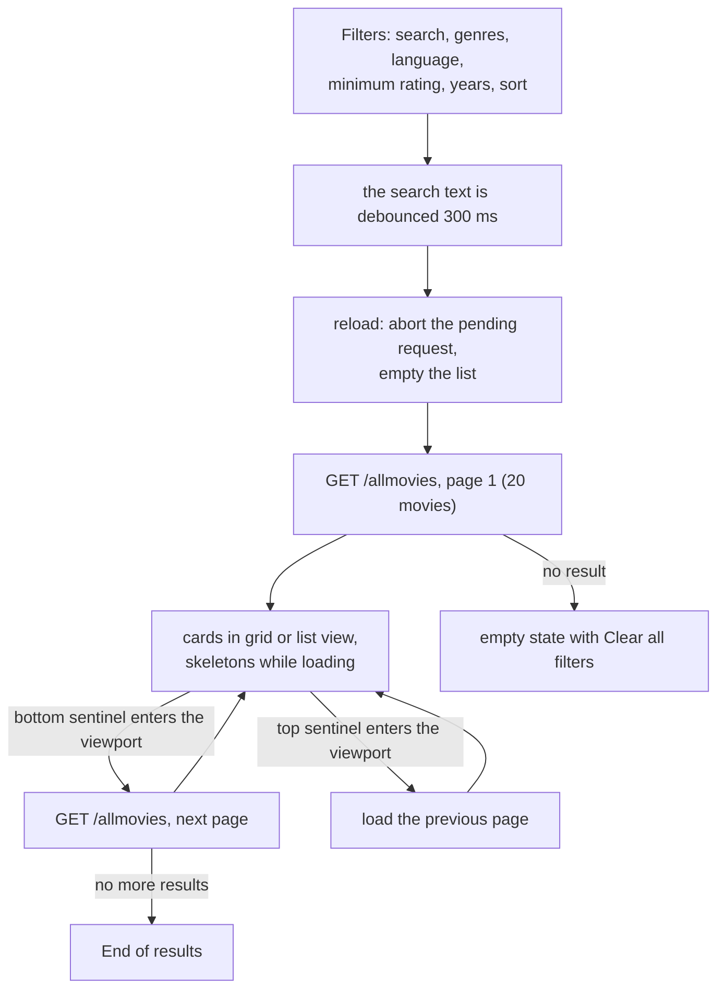

### What happens when you browse



### Inside the page



| Route | Purpose | Parameters |
|---|---|---|
| `GET /` | the React app (`frontend/build`) | |
| `GET /allmovies` | a page of movies, plus total, genre list and maxima | `start`, `end`, `title`, `genre` (repeatable), `lang`, `score`, `dates` (twice), `order_by`, `order_desc` |
| `GET /statistics` | quartiles and counts by language and genre for the charts page | `dates` (twice) |

Both API routes answer `201` with JSON. The `/statistics` page of the app draws its charts from that answer.


#### Caching

The movie data is a read-only CSV, so answers can be cached safely. Five layers, from the data to the browser:

| Layer | What | Details |
|---|---|---|
| Memory of each gunicorn worker (`backend/cache.py`) | the genre list / min year (once), then the JSON of `/statistics` by year range and of `/allmovies` pages of at most 100 movies (256 answers, least recently used first) | the fastest, but private to the worker. Big answers (e.g. the whole dataset) are never cached, to bound memory. |
| memcached (`memcached` service) | the same JSON answers, for 1 hour | shared by **all workers of all replicas**: the first one to get a request computes the answer, the others reuse it, and it survives a restart of the app. Optional: see below. |
| nginx (`nginx/nginx.conf`) | `/allmovies` and `/statistics` for 60 s, shared by all replicas | the `X-Cache-Status` response header says `HIT`, `MISS` or `BYPASS`. Send `X-No-Cache: 1` to skip it. |
| Cloudflare | see below | `Cache-Control` set by nginx |
| React Query, in the browser tab (`frontend/src/api.js`, `queryClient.js`) | every `/allmovies` and `/statistics` answer the page asked for | fresh for 5 minutes, kept 30. Asking again for a page already seen (same filters and sort), going back to a filter state you left, or coming back from the Statistics page costs **no request at all**. Identical requests in flight are shared. Lost when the tab is reloaded. |

The `X-App-Cache` response header tells where an answer came from: `memory` (the worker), `memcached` (another worker computed it) or `miss` (computed now).

memcached is configured by `MEMCACHED_SERVERS` (default `memcached:11211` in `docker-compose.yml`; several servers can be listed, separated by commas) and `MEMCACHED_TTL` (seconds, default 3600). Set `MEMCACHED_SERVERS=off`, or leave it unset (the default when you run gunicorn yourself), to use only the cache in each worker's memory: the app never needs memcached. If memcached is down or slow, the answer is simply computed, and memcached is not tried again for 10 seconds. The data version (size and date of `movies.csv`) is part of every key, so a new CSV never gets answers computed from the old one. To use it without Docker, see "With memcached" under "Deploy without docker".

memcached keeps its answers across restarts of the app, and the keys do not contain the version of the *code*: after changing how an answer is computed (a filter, a statistic), forget the old ones with `scripts/localcache.sh flush` (or restart the `memcached` container).

A browser cannot talk to memcached (it is a TCP protocol, not HTTP), so memcached serves the Flask replicas. The React app has its own cache in the browser instead, built on [React Query](https://tanstack.com/query) (already used for its provider in `index.js`).

**The React cache.** Both pages (the movie list and the statistics) fetch through one function, `cachedGet(queryClient, url, params, signal)` in `frontend/src/api.js`. The cache key is the URL and the params compared by value (the order of the keys of `params` does not matter, the order of the items of an array does). An error or a cancelled request (the page aborts the pending request when a filter changes) is never cached. The lifetimes are set in one place, `frontend/src/queryClient.js` (`staleTime` 5 minutes, `gcTime` 30 minutes): lower `staleTime` if the data can change while a page is open. The cache lives in the memory of the tab, so a reload starts empty and the server-side layers answer instead.

To load-test the replicas rather than the cache, run Locust with `NO_CACHE=1` (it sends `X-No-Cache: 1`):
```shell
NO_CACHE=1 locust -f backend/performance/locustfile.py --host=http://localhost:5000 --headless -u 100 -t 1m
```
The memory caches and nginx's cache are emptied when their container is recreated, e.g. after a redeploy (memcached too, as it has no volume).

#### Security hardening

The containers are locked down (`docker-compose.yml`, `Dockerfile`):

| Measure | Where |
|---|---|
| Runs as a non-root user: uid 10001 for the app and the pipeline, uid 101 for nginx (the `nginx-unprivileged` image, listening on port 8080), uid 70 for PostgreSQL, the image's `memcache` user for memcached | every service |
| All Linux capabilities dropped (`cap_drop: ALL`) and `no-new-privileges` | every service |
| Read-only root filesystem; only small `tmpfs` mounts are writable: `/tmp`, nginx's generated config and its response cache (`/var/cache/nginx`, in memory), PostgreSQL's socket directory (and its data volume) | `app`, `nginx`, `memcached`, `db` |
| Cap on the number of processes; memory limit | `app`, `nginx`, `memcached`, `db` (processes); `app`, `memcached` (memory) |
| Fully qualified image names (`docker.io/...`), so the registry is never guessed | all images |
| The database port is published on `127.0.0.1` only; memcached (no authentication) publishes no port at all, only the other containers can reach it | `db`, `memcached` |


## Podman

`podman compose` without the dash also works: it calls whichever compose tool is installed.) On macOS and Windows, first run `podman machine init && podman machine start`.

Things that differ from Docker:
- **Ports below 1024 cannot be published** without root, which is why nginx listens on 8080 (published as 5000).
- **Service names**: Podman's DNS is not at Docker's `127.0.0.11`. nginx therefore reads the DNS server from the container's `/etc/resolv.conf` when it starts (`nginx/nginx.conf` is a template), so the same file works on both.
- **No CPU limit** is set: a rootless Podman refuses to start a container with `cpus` unless the `cpu` cgroup controller is delegated to your user (`systemctl edit user@.service` with `Delegate=cpu cpuset io memory pids`). After that you can add `cpus: "1.0"` under `deploy.resources.limits`.
- **SELinux** hosts (Fedora, RHEL): the bind-mounted nginx file is relabelled with `:z`, already in the compose file.
- **Starting at boot**: `restart: unless-stopped` does not survive a reboot of a rootless setup. Run `loginctl enable-linger $USER`, then `podman-compose systemd -a create-unit` (or use Quadlet).
- **Health checks** (`podman ps` shows them) run from systemd timers: without systemd (e.g. WSL without systemd enabled) they stay at "starting", and `podman-compose up --wait` would wait forever. That is why nginx only waits for the app to be *started*, and the pipeline only for the database to be *started* (the loader retries its connection for about a minute).
- **The nginx response cache lives in memory** (a `tmpfs` of 128 MB, above the 100 MB `max_size` of the cache), so it is emptied at every restart and, like any container memory, does not survive a reboot.
- **The database volume** (`pgdata`) is a named volume of your user's Podman storage (`podman volume ls`). PostgreSQL runs as the image's own user (uid 70), which Podman maps to a sub-uid of yours; the volume's files are owned accordingly, so back it up with `podman volume export pgdata`, not by copying files from your home directory.

CI jobs `podman-test` and `podman-db-test` start the stack and the database profile with rootless Podman, and check the cache and that the containers run as non-root.


#### Cloudflare (optional)

Cloudflare can sit in front of nginx to give you HTTPS, DDoS/WAF protection and edge caching, without opening any inbound port. The stack then looks like: `Cloudflare -> cloudflared tunnel -> nginx -> app replicas`.

- **Tunnel**: the `cloudflared` service is in the `cloudflare` compose profile, so a plain `docker compose up` ignores it.
  1. In Cloudflare Zero Trust, go to *Networks > Tunnels*, create a tunnel and copy its token.
  2. In the tunnel, add a public hostname (a domain on your Cloudflare account) with the service set to `http://nginx:8080`.
  3. Put the token in a `.env` file (see `.env.example`, `.env` is git-ignored) and start the stack:
     ```shell
     CLOUDFLARE_TUNNEL_TOKEN=<token> docker compose --profile cloudflare up -d
     ```
- **Caching**: nginx sets the `Cache-Control` headers (`nginx/nginx.conf`): `/static/*` is cached for a year (the React build hashes file names), `/allmovies` and `/statistics` get `s-maxage=60`, everything else (including `index.html`) is `no-cache`. Cloudflare does not cache JSON by default: to cache the two API routes, add a *Cache Rule* (*Caching > Cache Rules*) for them with "Eligible for cache" and edge TTL "Use cache-control header if present".
- **Origin still reachable**: port `5000` stays published on the host, so the app can be reached without going through Cloudflare. Once the tunnel works, bind it to localhost (`127.0.0.1:${PORT:-5000}:8080` in the `nginx` service) or remove the published port.
- **Client IPs**: behind the tunnel, the client address is in the `CF-Connecting-IP` header (nginx currently sees the `cloudflared` container).
- **No account or domain?** `cloudflared tunnel --url http://localhost:5000` opens a temporary `https://<random>.trycloudflare.com` URL (no caching or WAF rules, for testing only).


On Debian and Ubuntu the `memcached` package also starts a system memcached on `127.0.0.1:11211`. The script then uses that one (and never stops it); if you prefer a separate private one, use another port: `MEMCACHED_PORT=11311`. Memory defaults to 64 MB (`MEMCACHED_MEMORY`). Windows: use WSL.