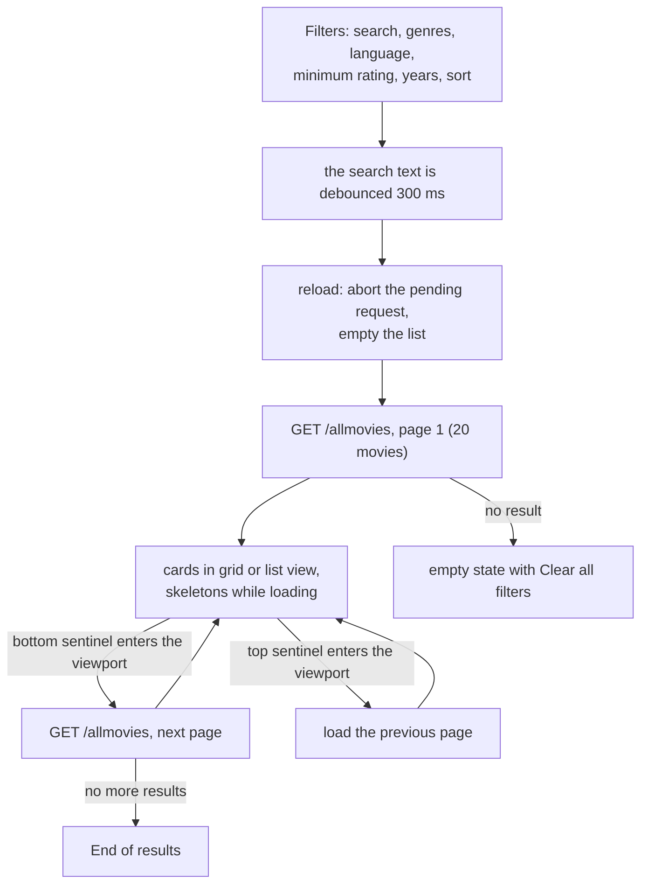

### Inside the page

| Route | Purpose | Parameters |
|---|---|---|
| `GET /` | the React app (`frontend/build`) | |
| `GET /allmovies` | a page of movies, plus total, genre list and maxima | `start`, `end`, `title`, `genre` (repeatable), `lang`, `score`, `dates` (twice), `order_by`, `order_desc` |
| `GET /statistics` | quartiles and counts by language and genre for the charts page | `dates` (twice) |

Both API routes answer `201` with JSON. The `/statistics` page of the app draws its charts from that answer.